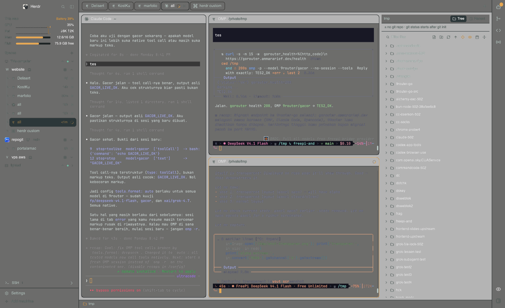
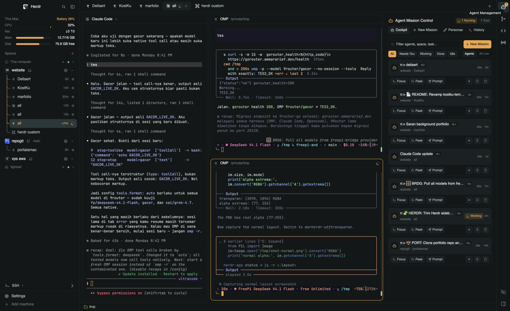

# Marherdr

A Herdr layout that follows your desktop. Two variants share one look: **marherdr-transparan** lets
your wallpaper and whatever is behind the window show through a frosted blur, **marherdr-offtransparan**
keeps the same arrangement solid. A toggle in the right rail flips between them.



**This PNG carries real alpha, not a gradient.** The window chrome is see-through in the file itself;
your image viewer decides what shows behind it.

## Two layouts

| Layout | Window | Use it when |
|---|---|---|
| `marherdr-transparan` | `window_blur: true`, chrome at 30% alpha | you want the desktop behind the window, blurred — Ghostty-style frost |
| `marherdr-offtransparan` | opaque, theme colours | screen sharing, projectors, or when text needs a flat background |

Both are the same four-icon rail, the same sidebar and the same panel stack. Only the window's
opacity differs, so switching does not reshuffle anything.



## The toggle

The right rail ends with an eye button, directly above the panel toggle:

- **eye-off** → transparency off
- **eye** → transparency on
- Click either way; it applies in about a second and survives a restart

It calls `layout.set` with the whole tree, so it does not need a file edit and works on whichever
layout you have open. The state lives in that layout's JSON, so if you want the toggle to stick,
switch layout after toggling or edit the file directly.

## What is on screen

**Right rail, 44 px.** Four icons and two controls. Top to bottom: Agent Management, Git Graph, Code
Snippets, Ports & Processes, then the transparency eye and the panel toggle. Icons are 18 px in 36 px
hit cells; `muted` normally, `foreground` on hover, `selected` while open.

**Left sidebar, 268 px.** Brand bar with the window buttons, machine vitals, machines and spaces,
SSH hosts, and a footer with settings and add-machine. That footer carries a red attention row when
an agent is blocked.

**Work column.** A 42 px tab strip drawn as a graph so branch and worktree relationships stay visible,
then the pane, then a 28 px status row with branch, directory, agent and progress.

**Panel column, 368 px, hidden by default.** Twelve blocks in a stack, one visible at a time:

| Block | Mod | On the rail |
|---|---|---|
| `agents` | `agent-manager` | yes |
| `graph` | `git` | yes |
| `snippets` | `snippets` | yes |
| `ports` | `ports` | yes |
| `files`, `ci`, `pr-flow`, `branch-pr`, `branch-issue`, `todo`, `factory`, `docker` | — | command palette or a keybind |

Type: `CommitMono Nerd Font` 12 px in terminals, `Uncut Sans` for the UI. Theme `cukup-malam`, with
`cukup-terang` for light mode and `cukup-kopi` / `cukup-senja` as alternates.

## Install

```sh
APP=~/.config/herdr-app          # or $HERDR_APP_HOME

cp marherdr/layouts/*.json      "$APP/layouts/"
cp marherdr/themes/cukup-*.json "$APP/themes/"
cp -R marherdr/mods/*           "$APP/mods/"

herdr-app do layout.switch --name marherdr-transparan
```

Skip the two `tabs-graph` and `activity-bar` mods only if you have not customised them — this repo
ships versions where the tab bar does not stack its own tint and the rail carries the eye toggle.

```sh
herdr-app check mods/activity-bar     # → check passed
ctrl-shift-l                           # cycle layouts
ctrl-alt-shift-escape                  # always back to main
```

## How the transparency works

Five keys, and all five are needed. Miss one and the window stays opaque.

```json
{
  "window_blur": true,
  "background": "chrome",
  "terminal_opacity": 0.15,
  "colors": {
    "background": "#1a161300",
    "canvas": "#1a161300",
    "chrome": "#1a16144d",
    "surface": "#1a161300",
    "raised": "#1a161300",
    "input": "#1a161300"
  }
}
```

- `window_blur` asks the window server for a frosted backdrop. On macOS 26 and later Herdr calls
  `CGSSetWindowBackgroundBlurRadius`; older systems use `NSVisualEffectView`.
- `colors.background` is the one people miss. It is the layer *under* everything: leave it opaque and
  no amount of alpha above it will show the desktop. This is what cost the longest to find.
- `colors.chrome` is the sidebar, tab bar and rail tint. `0x4d` ≈ 30 %.
- `terminal_opacity` makes the terminal's own background translucent. `0.15` matches the chrome tint,
  so the terminal and the sidebar read as one surface.
- `surface`, `raised` and `input` are transparent so mod panels match. `popover` stays solid on
  purpose: dialogs and menus have to stay readable.

### Tuning

| Want | Change |
|---|---|
| Sidebar more see-through | `chrome` → `#1a161433` (20 %) |
| Sidebar more solid | `chrome` → `#1a161466` (40 %) |
| Terminal lighter | `terminal_opacity` → `0.10` |
| Terminal more solid | `terminal_opacity` → `0.25` |
| No blur, sharp desktop | delete `window_blur` |

## Known limits

- **macOS 26+ only for the blur.** On Windows and some Wayland compositors `window_blur` uses GPUI's
  `Blurred`; untested here.
- **`colors.background` is mandatory.** Documented behaviour, but easy to miss — see above.
- **Mods are copies.** `activity-bar` and `tabs-graph` here carry two local changes (the eye toggle and
  a single-layer tab bar). A Herdr update replaces shipped mods, so re-copy those two afterwards.
- **Three helper binaries are not included.** `branch-pr`, `branch-issue` and `factory` ship a prebuilt
  Rust helper that was arm64 macOS only. Those panels render but their reads fail until you build the
  helper for your platform.
- **`gpui-kit.d.ts` is stripped** from each mod; Herdr rewrites it on start to match the running version.
- **Fonts are not bundled.** Missing fonts fall back to Herdr's defaults; nothing breaks.
- **`better-sidebar` starts ungrouped.** Its space-parent map is personal, so a fresh install looks
  flatter than the screenshots.

## Credits

The mods are Herdr's own shipped mods, copied from a running install; the layout and the two mod
edits are the work here. Shipped under the same terms Herdr ships them (`LICENSE`,
`THIRD-PARTY-NOTICES` in the app bundle; per-mod icon licences sit in each `icons/` folder).
