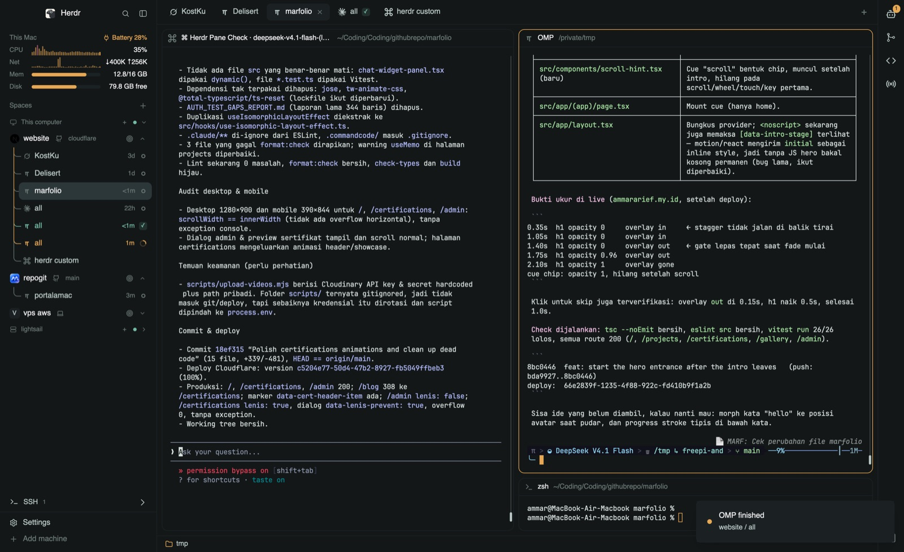

# Marherdr

A dark, low-chrome Herdr layout: collapsed icon rail on the right, machines and
spaces on the left, one panel stack that switches by icon.

## What you see

Left to right.

**Sidebar, 183–268 px, `chrome` background, not resizable.** Four blocks stacked:

- `brand` — 46 px, `workspace-chrome`, draggable window area, traffic lights at [12,16].
- `machine-vitals` — 120 px: CPU, memory and disk bars for this machine.
- `better-sidebar` — weight 1, min 90: machines, spaces, tabs. Local machine first.
- `ssh-hosts` — 32 px fixed: one row of hosts with their state.
- `workspace-chrome` with `footer: true` — 69 px: settings, add machine.

It collapses to a 44 px rail (76 px on macOS, room for the window buttons) when
you narrow it with `cmd-b`.

**Work column.**

- `tabs-graph` — 42 px tab strip, drawn as a graph so branch and worktree
  relationships stay visible. Draggable window area.
- `work-body` — row, 8 px padding, 8 px gap: the active pane (radius 10, 1 px
  `border`, `accent` on focus, 30 px header above) and the panel column.
- `session-bar` — 28 px status row: branch, directory, agent, progress.

**Panel column, 368 px, hidden by default.** A `stack` of eleven blocks, one
visible at a time: `filetree`, `git` (graph), `ci-dash`, `pr-flow`, `branch-pr`,
`branch-issue`, `todo`, `factory`, `agent-manager`, `docker`, `snippets`, `ports`.

**Activity bar, 44 px, far right, not resizable.** Vertical icon rail, icons 18 px
in 36 px hit cells, 4 px gap, `chrome` background, `muted` icons that go
`foreground` on hover with a `hover` background. Active item gets `selected`.

Top to bottom, only four: Agent Management, Git Graph, Code Snippets, Ports &
Processes. A toggle at the bottom opens and closes the panel.

Type: `CommitMono Nerd Font` 12 px in terminals, `Uncut Sans` for the UI.
Theme `cukup-malam`, switching to `cukup-terang` in light mode.

## How it behaves

Click an icon: if its panel is closed or a different one is shown, select it in
`panel-body` and show `panel`. Click the icon already open: hide `panel`. The
bottom toggle shows or hides `panel` without changing which block is selected.

The Agents icon carries a live badge from `agents()`, capped at `99+`: red
`blocked` if any agent is blocked, otherwise blue `working`. Other icons read
`shared("mod-badges")`, either a number or a map keyed by space id.

`nextCommand()` in the activity bar's `init` lets `cmd`-level commands switch
panels without a click.

Agent status colours: working is `working`, blocked is `blocked`, done is `done`,
idle is `dim`. A blocked agent also raises the sidebar footer's attention row.

## Built from

Root is a `row` of `sidebar`, `work`, `activity-bar`.

- `sidebar`: column, 268 px, min 44, max 480, `resizable: false`, `chrome`.
- `work`: column, `resizable: false`, children `tab-bar` (42 px row wrapping
  `tabs-graph`), `work-body` (row, padding 8, gap 8), `status-row` (28 px row
  wrapping `session-bar`).
- `panel`: column inside `work-body`, 368 px, min 280, max 900, `hidden: true`.
- `activity-bar`: block, 44 px, `resizable: false`.

Mods, all `place: none`: `workspace-chrome`, `machine-vitals`, `better-sidebar`,
`ssh-hosts`, `tabs-graph`, `pane`, `session-bar`, `filetree`, `git`, `ci-dash`,
`pr-flow`, `branch-pr`, `branch-issue`, `todo`, `factory`, `agent-manager`,
`docker`, `snippets`, `ports`, `activity-bar`.

Themes: `cukup-malam` (dark) and `cukup-terang` (light), plus `cukup-kopi` and
`cukup-senja` as alternates.

Commands used: `layout.hide`, `layout.show`, `layout.select`. Data:
`layout()`, `theme()`, `spaces()`, `agents()`, `shared()`.

Three mods ship a Rust helper binary and are excluded here because the build is
`arm64` macOS only: `branch-pr/bin/herdr-pr`, `branch-issue/bin/herdr-linear`,
`factory/bin/factory`. Those panels still render but their reads fail until you
rebuild the helper for your platform. Same for the shipped `gpui-kit.d.ts` type
files in each mod: Herdr rewrites them on start, so they are not in this repo.

## Watch out

- The activity bar lists only these four ids. Adding a fifth means adding it to
  `items` in `mods/activity-bar/main.js` and giving `panel-body` a block with that
  id; `togglePanel` silently does nothing when the id is missing.
- Rail width is 44 px; on macOS the sidebar needs 76 px or more while expanded so
  the traffic lights do not land on the brand block. `traffic_lights: [12, 16]`
  assumes that.
- `panel` starts `hidden: true`. A fresh install shows no panel until you click an
  icon; that is intended, not a broken layout.
- `better-sidebar` keeps its own space-parent map in `shared.json`. A fresh
  install starts with no grouping, which is fine but looks flatter than
  `preview.jpg`.
- The layout sets `terminal_menu: "menu"`, so right-click opens a menu instead of
  acting directly.
